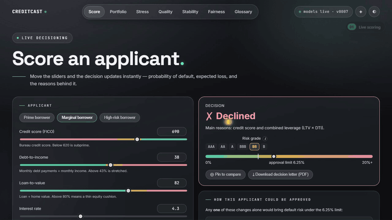

# CreditCast

[](https://github.com/Eyeroniq/CreditCast/actions/workflows/ci.yml)

<p align="center">
  
</p>
<p align="center"><em>Live scoring, a decline turned into an approval by the what-if panel, and the portfolio view.</em></p>

**Bank-grade credit-risk modeling & validation platform.** A calibrated PD model
(regulatory WoE scorecard *and* an ML challenger), LGD, and EAD combined into
Expected Loss — wrapped in a bank-grade validation suite, SHAP explainability,
fairness testing, and drift monitoring. Built to the global Basel/IRB methodology
on mortgage-performance data.

```
EL = PD × LGD × EAD
```

> Methodology is jurisdiction-agnostic (Basel/IRB). The data comes from a
> **seeded synthetic generator** that follows the **Freddie Mac Single-Family**
> loan + monthly-performance schema, so the whole stack runs offline and
> reproducibly.

## Run the demo (Windows)

```powershell
powershell -ExecutionPolicy Bypass -File scripts\demo.ps1
```

Then open http://localhost:8000. See [DEMO.md](DEMO.md) for a 10-minute walkthrough
and troubleshooting. The AI Copilot is hidden from the menu until the server has
a `GROQ_API_KEY` and the dashboard is built with `NEXT_PUBLIC_SHOW_COPILOT=1`.

## Quickstart

```bash
python3 -m venv .venv && source .venv/bin/activate
pip install -r requirements.txt          # macOS LightGBM: brew install libomp
python -m creditcast.cli generate       # synthetic GSE panels -> Bronze
python -m creditcast.cli pipeline       # Bronze -> Silver -> Gold (+ OOT split); --engine spark for PySpark
python -m creditcast.cli train          # scorecard + challenger + calibration
python -m creditcast.cli validate       # Gini/KS/calibration/PSI -> report
python -m creditcast.cli all            # the whole lifecycle end-to-end
```

Run the tests with `python -m pytest`. CI runs the tests, the full lifecycle
with its performance gates, and the dashboard build on every push and PR.

For dashboard development with hot reload, run the API and the Next.js dev
server separately and allow the dev origin (the API is same-origin only by
default):

```bash
CC_ALLOWED_ORIGINS=http://localhost:3000 uvicorn app.api.main:app --reload --port 8001
cd app/dashboard && NEXT_PUBLIC_API_URL=http://localhost:8001 npm run dev
```

## Code quality

CI enforces the same checks you can run locally:

```bash
ruff check .            # lint (config in pyproject.toml)
ruff format .           # format
mypy                    # type-check the decision-making core
python -m pytest        # 120+ tests incl. an in-process end-to-end lifecycle; 80% coverage floor
cd app/dashboard && npm run lint
cd app/dashboard && npm test        # component tests (Vitest)
# end-to-end (Playwright), against a running app on :8000 with trained models;
# PW_CHANNEL=msedge (or chrome) uses an installed browser instead of a download
cd app/dashboard && E2E_BASE_URL=http://127.0.0.1:8000 npx playwright test
```

Optional git hooks: `pip install pre-commit && pre-commit install`. To skip the
bulk-formatting commit in `git blame`: `git config blame.ignoreRevsFile .git-blame-ignore-revs`.

## Dependencies

Library versions are **locked**. Edit the loose lists `requirements.in` /
`requirements-serve.in`, then regenerate the pinned, hash-checked lock files
(`requirements.txt` / `requirements-serve.txt`) with
[uv](https://docs.astral.sh/uv/):

```bash
pip install "uv==0.12.23"
sh scripts/lock-deps.sh              # after adding/removing a package
sh scripts/lock-deps.sh --upgrade    # move to the latest allowed versions
```

Commit the `.in` and `.txt` files together. CI fails if they are out of sync.
After an `--upgrade`, check the metrics in the CI job summary before merging:
an upgrade can change results.

## Deploy (single container)

The whole app ships as one Docker image: FastAPI serves the API under `/api` and
the pre-built static Next.js cockpit at `/` (one origin, no CORS). Models are
trained and baked at build time, so the runtime image only serves.

```bash
docker build -t creditcast .
docker run -p 8000:8000 creditcast        # open http://localhost:8000
```

**Production:** self-hosted at **[dhyyraj.in](https://dhyyraj.in)** with Docker
Compose and Caddy (automatic HTTPS):

```bash
docker compose -f deploy/docker-compose.yml up -d --build
```

Server, DNS and secret setup: [`deploy/README.md`](deploy/README.md).

## Architecture (lifecycle, not an agent graph)

```
Bronze (raw, vintage-partitioned)
  -> Silver (cleaned, point-in-time 12m default flag, perf joined)
    -> Gold (leakage-safe feature matrix + target, vintage-tagged)
      -> OOT split (train: old vintages / test: new vintages)
        -> PD scorecard (WoE/IV + logistic)  ─┐
        -> PD challenger (LightGBM)           ─┼─> calibration (isotonic)
                                               │
        -> LGD (two-stage) -> EAD/CCF ─────────┴─> Expected Loss
          -> Validation (Gini/KS/gains, calibration/HL, PSI/CSI, benchmark)
            -> Governance (SHAP, reason codes, fairness, model card)
              -> Serving (FastAPI) + Risk Cockpit (Next.js) + drift monitoring
                -> Risk Copilot (agent team over the platform tools)
```

## Risk Copilot — the agent layer

A specialist **agent team** sits on top of the platform (LLM orchestration only;
the model core stays classical ML). A **Portfolio Analyst**, **Model Validator**,
and **Fairness Officer** each wield a focused toolbelt over the *real* tools
(scoring, portfolio slices, validation metrics, fairness, SHAP drivers). An
orchestrator routes a question to the right specialist(s); answers come back with
**interactive charts the agents emit** and a transparent **tool trace**. Numbers
come from the models, never the LLM.

- Backend: [`creditcast/agents/`](creditcast/agents/) — tools, Groq tool-calling
  loop (forced first call for grounding; auto-fallback to a lighter model on
  rate-limit), specialists, orchestrator. Endpoints: `/api/agent/team`, `/api/agent/chat`.
- Frontend: the **Risk Copilot** screen — chat, the visible team (lights up which
  specialists fired), live charts, and the agent/tool trace.
- Free LLM backend via **Groq**. Set `GROQ_API_KEY` (an environment variable
  locally; the server's `.env` file in production, see `deploy/README.md`).
  Everything else runs without it.

## Why this is bank-credible, not a Kaggle notebook
The model is ~20% of the work. The 80% that proves maturity is the scaffolding:
**leakage-safe point-in-time target, out-of-time validation**, WoE scorecards,
calibration, Gini/KS/PSI, adverse-action reason codes, fairness, a model card,
CI performance gates, and drift monitoring.

## Spark engine (optional)

The pipeline also runs on **PySpark** (`creditcast/pipeline/spark/`), for books
too big for one machine. DuckDB stays the default; the Spark engine writes the
same Gold files (checked value for value by `cli parity` and the tests), so
training and serving don't change. It needs Java 17+, so the easy way is its
container:

```bash
docker build -f Dockerfile.spark -t creditcast-spark .
docker run --rm -v "$PWD:/app" creditcast-spark python -m creditcast.cli pipeline --engine spark
docker run --rm -v "$PWD:/app" creditcast-spark python -m creditcast.cli parity
```

Or natively: install Java 17+, then `pip install -r requirements-spark.txt`.
Design, benchmark and when to pick which engine: [docs/pyspark.md](docs/pyspark.md).

## Layout
```
creditcast/
  conf/config.yaml      # all thresholds/scaling/cutoffs — no hardcoding
  pipeline/             # synthetic generator + Bronze/Silver/Gold + split
    spark/              # the same pipeline on PySpark (--engine spark)
  models/               # scorecard, challenger, calibration, lgd, ead, el
  validation/           # discrimination, calibration_tests, stability, report
  governance/           # shap_explain, reason_codes, fairness, model_card
  monitoring/           # scheduled PSI drift
  eval/                 # CI performance gates (Gini/cal/PSI thresholds)
  agents/               # Risk Copilot: tools, Groq loop, specialists, orchestrator
  features.py           # engineered features shared by pipeline + serving
app/api/                # FastAPI scoring service (+ /api/agent/*)
app/dashboard/          # Next.js Risk Cockpit (6 screens, incl. Risk Copilot)
deploy/                 # docker-compose + Caddy for dhyyraj.in
tests/                  # labels, leakage, features, EAD, threshold, explain, agents
.github/workflows/      # CI
```

The leakage discipline is the keystone: features use only information available
at the observation date, the target looks forward 12 months, and the split is
out-of-time — never random. That is what separates a credible credit model from
a leaky one.
